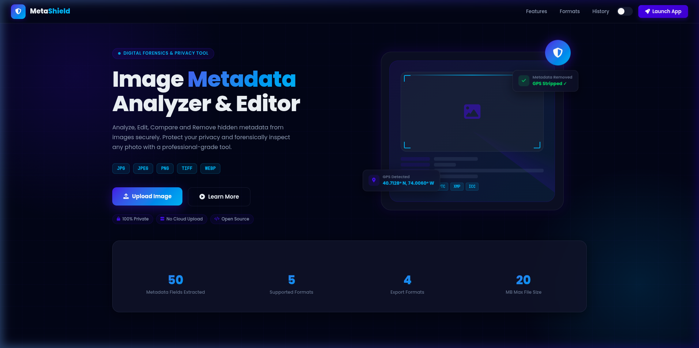
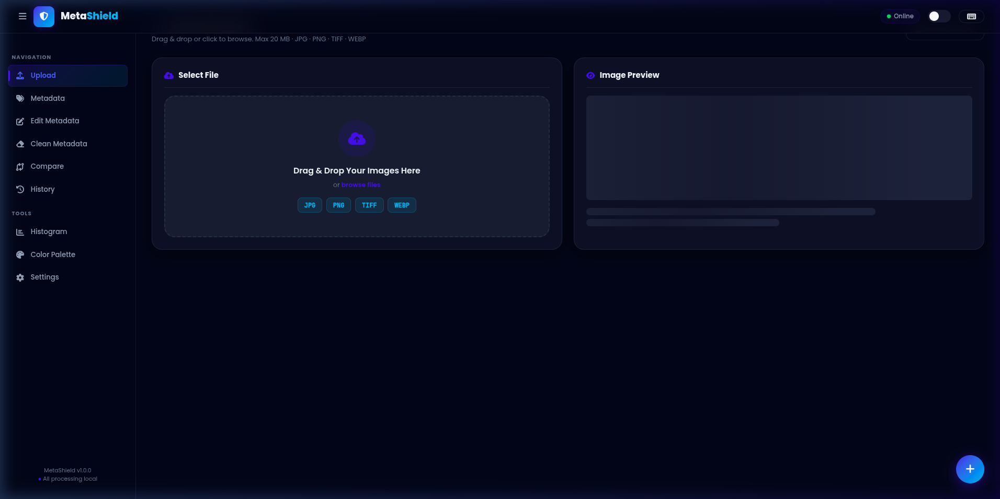
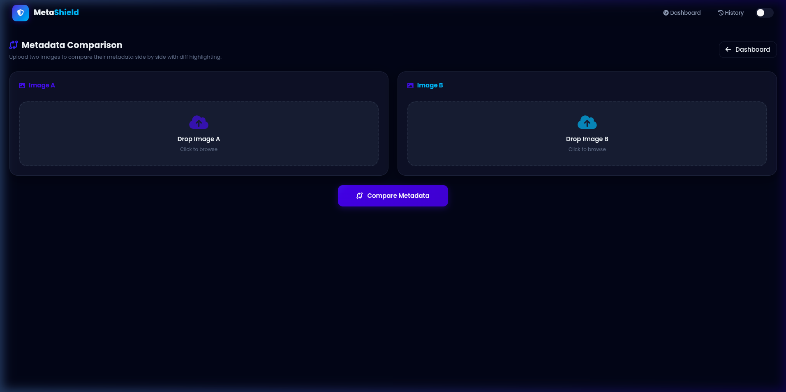
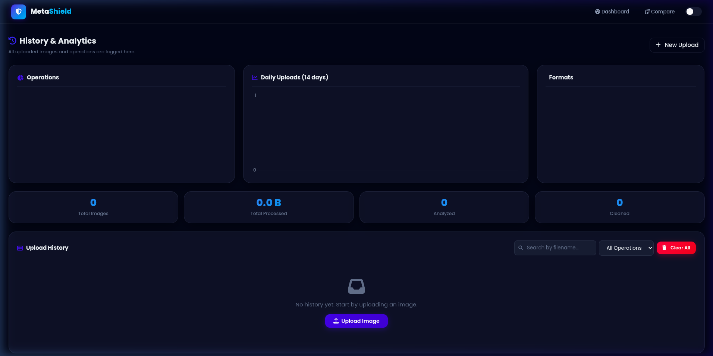

<div align="center">

# 🛡️ MetaShield 🛡️

### Image Metadata Analyzer & Editor

**Analyze · Edit · Compare · Remove** hidden metadata from images — securely and privately.

[](https://python.org)
[](https://flask.palletsprojects.com)
[](https://getbootstrap.com)
[](https://meta-shield-2xyi.vercel.app/)
[](LICENSE)

### 🌐 [View Live Project](https://meta-shield-2xyi.vercel.app/) 🌐


> A production-ready cybersecurity web application for digital forensics professionals,  
> privacy-conscious users, and software developers.

</div>

---

## 📸 Screenshots

### 🏠 Landing Page
> Glassmorphism hero with animated background, feature cards, and live statistics.



---

### 📊 Dashboard
> Drag & drop upload zone, image preview with zoom/rotate, tabbed metadata viewer, GPS map, editor, and cleaner — all in one sidebar-driven layout.



---

### 🔀 Metadata Compare
> Upload two images and instantly see a color-coded diff — Added, Removed, Changed, Same — with search and filter controls.



---

### 📜 History & Analytics
> Every operation is logged in SQLite. Paginated history table with operations pie chart, daily uploads line chart, and file-format donut chart.



---

## ✨ Features

### 🔍 Metadata Analysis
- Extract **50+ EXIF fields** – camera model, lens, ISO, aperture, exposure, white balance, flash, focal length
- **GPS location** detection with Leaflet.js interactive map + Google Maps link
- XMP, IPTC, ICC Profile, embedded thumbnail detection
- Raw EXIF tag viewer with all unknown tags
- Copy all metadata to clipboard in one click

### ✏️ Metadata Editor
- Edit **Author, Copyright, Description, Software, Keywords, Title, Artist, Comment**
- Supports DateTime, UserComment, Windows XP metadata fields
- Downloads modified image instantly — original untouched

### 🧹 Metadata Cleaner
- Selectively remove: **EXIF · GPS · IPTC · XMP · Comments · Thumbnail · ICC Profile**
- Or **Remove All** metadata with one click
- Configurable JPEG/WebP output quality slider
- **Batch processing** — clean multiple images, download as single ZIP

### 🔀 Side-by-Side Compare
- Upload two images and view a **color-coded diff table**
- Status labels: `CHANGED` · `ADDED` · `REMOVED` · `SAME`
- Filter by status + search by field name

### 📊 Visual Tools
- **RGB Histogram** — Chart.js visualization of per-channel pixel distribution
- **Color Palette** — Extract 8 dominant colors via median-cut; click any swatch to copy hex
- **Image preview** with fullscreen zoom, rotate, and one-click download

### 📦 Export
| Format | Description |
|--------|-------------|
| **JSON** | Complete metadata as pretty-printed JSON |
| **CSV** | Two-column key/value spreadsheet |
| **TXT** | Formatted human-readable text report |
| **PDF** | Professionally styled report via ReportLab |

### 📜 History & Analytics
- Every operation logged in **SQLite** (auto-created, no setup needed)
- Operations breakdown (pie chart), Daily uploads for last 14 days (line chart), Format distribution (donut chart)
- Search, filter, paginate history; delete individual records or clear.

### 🎨 UI/UX
- **Glassmorphism dark/light theme** — persisted preference
- Animated hero section with floating cards and scan-line effect
- Skeleton loading states, AOS scroll animations, progress bars
- Toast notifications, SweetAlert2 confirmation dialogs
- Floating Action Button, button ripple effects, micro-interactions
- Fully **responsive** — desktop · tablet · mobile

---

## 📁 Project Structure

```
MetaShield/
├── app.py                      ← Flask application & all API routes
├── config.py                   ← Configuration constants
├── requirements.txt            ← Python dependencies
│
├── utils/
│   ├── metadata.py             ← EXIF extraction (Pillow + piexif + exifread)
│   ├── cleaner.py              ← Metadata removal (selective & batch)
│   ├── editor.py               ← Metadata field editing (piexif)
│   ├── compare.py              ← Side-by-side metadata diff
│   └── export.py               ← JSON / CSV / TXT / PDF export (ReportLab)
│
├── templates/
│   ├── index.html              ← Animated landing page
│   ├── dashboard.html          ← Main application (upload, view, edit, clean)
│   ├── compare.html            ← Two-image metadata comparison
│   └── history.html            ← History & analytics dashboard
│
├── static/
│   ├── css/style.css           ← Full custom CSS (glassmorphism, dark/light)
│   ├── js/app.js               ← Complete frontend JavaScript
│   ├── uploads/                ← Uploaded images (runtime, not committed)
│   └── downloads/              ← Processed outputs (runtime, not committed)
│
└── docs/                       ← Screenshots for README
    ├── landing.png
    ├── dashboard.png
    ├── compare.png
    └── history.png
```


---

## ⌨️ Keyboard Shortcuts

| Shortcut | Action |
|----------|--------|
| `Ctrl + U` | Go to Upload section |
| `Ctrl + M` | Go to Metadata section |
| `Ctrl + E` | Go to Edit Metadata |
| `Ctrl + D` | Go to Clean Metadata |
| `Ctrl + B` | Toggle sidebar |
| `Ctrl + T` | Toggle dark / light theme |
| `F` | Fullscreen image preview |
| `Esc` | Close  |

---

## 🛡️ Security

| Feature | Detail |
|---------|--------|
| File validation | Extension allowlist: `jpg jpeg png tiff webp` |
| Size limit | 20 MB maximum per file |
| Filename sanitisation | `secure_filename()` + regex strip |
| Path traversal prevention | All filenames sanitised before disk I/O |
| Rate limiting | 30 uploads / hour per IP (in-memory) |
| Local processing | No data ever sent to external servers |

---

## 🧩 Tech Stack

### Backend
| Library | Version | Purpose |
|---------|---------|---------|
| Flask | 3.1 | Web framework & routing |
| Pillow | 11.1 | Image I/O, EXIF, histogram, color palette |
| piexif | 1.1.3 | Structured EXIF read / write / edit |
| exifread | 3.0 | Extended raw tag extraction |
| ReportLab | 4.2.5 | PDF report generation |
| SQLite | stdlib | Upload history & analytics |

### Frontend
| Library | Version | Purpose |
|---------|---------|---------|
| Bootstrap | 5.3 | Responsive grid & components |
| Chart.js | 4.4 | Histogram, pie, line, donut charts |
| Leaflet.js | 1.9 | Interactive GPS map |
| SweetAlert2 | 11 | Confirmation dialogs |
| AOS | 2.3 | Scroll animations |
| Font Awesome | 6.5 | Icon library |
| Poppins / JetBrains Mono | — | Typography |

---

## 🤝 Contributing

1. Fork the repository
2. Create a feature branch (`git checkout -b feature/amazing-feature`)
3. Commit your changes (`git commit -m 'Add amazing feature'`)
4. Push to the branch (`git push origin feature/amazing-feature`)
5. Open a Pull Request

---

## 📜 License

Distributed under the **MIT License**. See [`LICENSE`](LICENSE) for more information..

---

<div align="center">

## 👨‍💻 Developed by

**Gnanasekaran V**

[](https://github.com/vgnanasekaran007-hub)
[](mailto:vgnanasekaran007@gmail.com)
[](https://meta-shield-2xyi.vercel.app/)

---

Made with ❤️ using Flask · Pillow · Bootstrap 5 · Chart.js · Leaflet.js

⭐ **Star this repo** if you found it useful!!!

</div>
